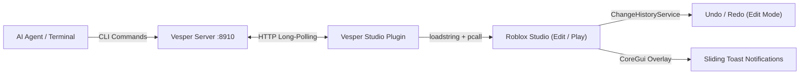

<div align="center">
  
  <h1>VESPER</h1>
  <p><strong>Fast, zero-friction Roblox Studio bridge for AI pair programmers and Luau automation</strong></p>

  <p>
    <a href="https://create.roblox.com"></a>
    &nbsp;&nbsp;
    <a href="https://nodejs.org"></a>
    &nbsp;&nbsp;
    <a href="LICENSE"></a>
  </p>
</div>

---

Vesper connects AI pair programmers (Antigravity, Claude Code, Cursor, Windsurf, Aider) and CLI scripts directly to **Roblox Studio**. 

It runs batch Luau builders, queries live mouse selections, snaps viewport cameras, inspects instance properties, and applies world geometry with native `Ctrl+Z` undo/redo tracking (`ChangeHistoryService`) in Edit Mode, plus live runtime inspection during Play Mode.

Built for Roblox developers building games on **Linux (Vinegar/Wine)**, **macOS**, and **Windows**.

---

## How It Works

Vesper consists of two lightweight pieces:
1. **The CLI (`vesper`)**: Runs on your machine, managing the bridge server on port `8910`.
2. **The Studio Plugin**: Runs inside Roblox Studio, executing Luau instructions with `Ctrl+Z` undo tracking in Edit Mode, live testing during Play Mode, and in-viewport toasts.

---

## Setup & Getting Started

### 1. Install the CLI

```bash
# npm
npm install -g @raxelf/vesper

# bun
bun add -g @raxelf/vesper

# pnpm
pnpm add -g @raxelf/vesper
```

Or run directly without installing:

```bash
npx @raxelf/vesper serve
```

### 2. Auto-Install Studio Plugin

Run one command to detect your operating system (Linux Vinegar/Wine, macOS, Windows) and copy the plugin:

```bash
vesper setup
```

<details>
<summary>Manual Plugin Installation Paths</summary>

If you prefer manual copying, place `plugin/Vesper.server.lua` into:

| Operating System | Studio Plugins Directory |
|---|---|
| **Linux (Vinegar Flatpak)** | `~/.var/app/org.vinegarhq.Vinegar/data/vinegar/prefixes/studio/drive_c/users/$USER/AppData/Local/Roblox/Plugins/` |
| **Linux (Standard Wine)** | `~/.wine/drive_c/users/$USER/AppData/Local/Roblox/Plugins/` |
| **macOS** | `~/Library/Application Support/Roblox/Plugins/` |
| **Windows** | `%LOCALAPPDATA%\Roblox\Plugins\` |
</details>

### 3. Connect Studio

1. In Roblox Studio, open **Home** → **Game Settings** → **Security** and toggle **Allow HTTP Requests** ON.
2. In the **Plugins** ribbon, click the **Vesper** button and click **Connect**.
3. Done! Run commands from your terminal or AI coding agent:

```bash
# Inspect what is currently selected in Studio with your mouse
vesper sel

# Teleport / focus camera on any model or part
vesper view Workspace.Arena

# Inspect 3D world hierarchy
vesper tree Workspace

# Inspect full serialized JSON properties
vesper props Workspace.Baseplate

# Execute Luau directly in Studio
vesper exec "Instance.new('Part', workspace).Name = 'VesperCube'"

# Run complex batch builder scripts
vesper run /tmp/build.luau
```

---

## CLI Reference

| Command | Arguments | Description |
|---|---|---|
| `vesper setup` | None | Auto-installs Studio plugin to your Roblox Plugins folder. |
| `vesper serve` | None | Starts bridge server in foreground on port `8910` (`Ctrl+C` to stop). |
| `vesper status` | None | Checks if server is running and Roblox Studio is connected. |
| `vesper sel` | None | Inspects instances currently selected with the mouse in Studio. |
| `vesper view` | `[path]` | Focuses Studio camera on an instance (defaults to `Workspace`). |
| `vesper tree` | `[path]` | Dumps 3D world hierarchy (defaults to `Workspace`). |
| `vesper props` | `<path>` | Returns JSON properties of an instance. |
| `vesper run` | `<file.luau \| code>` | Executes batch Luau builder script in Studio. |
| `vesper exec` | `"<code/>"` | Executes inline Luau string in Studio. |
| `vesper version` | None | Prints current version string. |

> **Note:** Run `vesper serve` in a terminal when developing. Press `Ctrl+C` anytime to stop the server cleanly.

---

## AI Agent Integration

Vesper is built for autonomous and interactive AI workflows. Add this rule to your agent system prompt or `.cursorrules`:

```markdown
# Roblox Studio AI Bridge (`vesper`)

For Roblox Studio manipulation, use the global CLI `vesper`:
- `vesper status` — Verify bridge server and Roblox Studio connection status.
- `vesper sel` — Inspect instances currently selected with the mouse in Studio.
- `vesper view <path>` — Focus/teleport the Studio camera onto an instance or model.
- `vesper tree Workspace` — Inspect 3D world hierarchy, positions, sizes, and colors.
- `vesper props Workspace.Model` — Inspect JSON properties of an instance.
- `vesper run /tmp/build.luau` — Execute a batch Luau builder script in Studio.
- `vesper exec "print(...)"` — Run quick inline Luau commands.
- **Rule**: Always batch 3D map/model generation into a single script written to `/tmp/build.luau` and executed via `vesper run /tmp/build.luau`.
```

---

## Architecture



1. **Lightweight Server (`node:http`):** Binds to `127.0.0.1:8910`, queues client requests (`/cmd`), and serves long-polling workers (`/poll`).
2. **Studio Plugin (`Vesper.server.lua`):** Polls the server asynchronously inside Studio, unpacks instructions, executes them (with `ChangeHistoryService` recordings in Edit mode), and posts results back (`/reply`).
3. **In-Viewport Toasts:** Studio viewport displays sliding status notifications confirming applied changes without requiring the developer to look at the output window.

---

## License

[MIT](LICENSE) © raxelf
