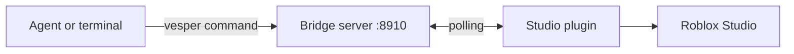

<div align="center">
  
  <h1>VESPER</h1>
  <p><strong>A small bridge between AI agents and Roblox Studio, driven from the command line</strong></p>

  <p>
    <a href="https://create.roblox.com"></a>
    &nbsp;&nbsp;
    <a href="https://nodejs.org"></a>
    &nbsp;&nbsp;
    <a href="LICENSE"></a>
  </p>
</div>

---

Vesper lets an AI coding agent (Claude Code, Cursor, Aider and similar) work inside a running Roblox Studio from a plain CLI. It runs Luau, dumps the hierarchy, takes screenshots, and play-tests the game while the agent watches the result. Every edit is one `Ctrl+Z` step.

Compared with an MCP server on the jobs they share, Vesper needs about 244 tokens of fixed context instead of about 2,900 for the matching tools (about 15,200 for all 28 of that server's tools). A command takes about 16 ms instead of 33 to 66 ms, and screenshots take about the same time. Vesper does less: no script editing, input simulation or asset generation. It also tops out at roughly 250 commands a minute because of Roblox's HTTP limit. [Method and full numbers](#compared-with-an-mcp-server).

## Requirements

- Roblox Studio on Windows, macOS, or Linux through Vinegar or Wine.
- Node.js 18 or newer (Bun also works).
- "Allow HTTP Requests" turned on for the place you work in.

## Install

```bash
npm install -g @raxelf/vesper
```

Bun and pnpm work too (`bun add -g`, `pnpm add -g`). To try it without installing, use `npx @raxelf/vesper serve`.

Then install the Studio plugin. This detects your system and copies the plugin into Studio's plugins folder:

```bash
vesper setup
```

<details>
<summary>Install the plugin by hand</summary>

Copy `plugin/Vesper.server.lua` into:

| System | Plugins folder |
|---|---|
| Linux (Vinegar Flatpak) | `~/.var/app/org.vinegarhq.Vinegar/data/vinegar/prefixes/studio/drive_c/users/$USER/AppData/Local/Roblox/Plugins/` |
| Linux (Wine) | `~/.wine/drive_c/users/$USER/AppData/Local/Roblox/Plugins/` |
| macOS | `~/Library/Application Support/Roblox/Plugins/` |
| Windows | `%LOCALAPPDATA%\Roblox\Plugins\` |
</details>

## Quick start

1. Restart Studio after `vesper setup` so it loads the plugin.
2. In a terminal, start the bridge and leave it running: `vesper serve`
3. In Studio, open Game Settings, then Security, and turn on Allow HTTP Requests. In the Plugins ribbon, click Vesper, then Connect to Bridge.
4. Try it from another terminal:

```bash
vesper tree Workspace 2
vesper exec "Instance.new('Part', workspace).Name = 'VesperCube'"
vesper shot /tmp/view.png
```

Press `Ctrl+Z` in Studio to undo the cube.

## Commands

| Command | Arguments | What it does |
|---|---|---|
| `vesper setup` | | Installs the Studio plugin. |
| `vesper serve` | | Starts the bridge on `127.0.0.1:8910`. Stop it with `Ctrl+C`. |
| `vesper status` | | Shows whether the server is up and Studio is connected. |
| `vesper tree` | `[path] [depth]` | Dumps the hierarchy with part positions, sizes and colours. Defaults to `Workspace`, depth 4, at most 400 lines. |
| `vesper run` / `vesper exec` | `<file.luau \| code>` | Runs Luau in Studio as one `Ctrl+Z` step. Returns what the script printed and returned. |
| `vesper test` | `<file.luau \| code> [seconds]` | Starts a Play session, runs the script on the server, prints PASS or FAIL with the game's logs, then stops. |
| `vesper shot` | `[file.png] [--from x,y,z --at x,y,z] [--width n]` | Saves a PNG of the Studio viewport (default 640 px wide, at most 1280). With `--from` and `--at` the camera moves for the shot and is put back afterward. Edit mode only. |
| `vesper version` | | Prints the version. |

`run`, `exec` and `test` print at most 200 lines (the first 40 and the last 160) so an agent's context doesn't fill up. Add `--full` to see everything.

### Testing a running game

Inside a `vesper test` script, call `shot("name")` to save a screenshot of the running game to `/tmp/vesper-shots/name.png`. The paths are printed under SCREENSHOTS. A script can walk a character to a part, check where it ended up, and take a picture:

```lua
local hum = game.Players:GetPlayers()[1].Character.Humanoid
hum:MoveTo(workspace.Door.Position)
hum.MoveToFinished:Wait()
shot("at-door")
assert((hum.RootPart.Position - workspace.Door.Position).Magnitude < 8)
```

Screenshots show what the player's camera sees. Scripts can't press keys or click UI.

## Using it with an agent

Add this to your agent's instructions (`CLAUDE.md`, `.cursorrules` or a system prompt):

```markdown
# Roblox Studio bridge (`vesper`)

Use the `vesper` CLI to work in Roblox Studio:
- `vesper status`: check the bridge and Studio connection.
- `vesper tree Workspace`: inspect the hierarchy.
- `vesper run /tmp/build.luau`: run a Luau script. Batch map and model generation into one script.
- `vesper exec "print(...)"`: run a quick inline command.
- `vesper shot /tmp/view.png --from x,y,z --at x,y,z`: save a viewport screenshot, then open the PNG to check what you built. The 3D scene tab must be active in Studio.
- `vesper test /tmp/check.luau`: run a script in a Play session and read PASS or FAIL plus logs. In the script, call `shot("name")` after a key step and open the PNG.

After you change gameplay scripts, write a short check to /tmp/check.luau, run it with `vesper test`, fix any errors and run it again until it passes. Skip this for purely visual builds and use `vesper tree` or `vesper shot` instead.
```

## Compared with an MCP server

Vesper does three jobs: run Luau, read the hierarchy, and test in a Play session with screenshots. An MCP server for Studio does those and more. The one I measured has 28 tools, including script editing, input simulation and asset generation, none of which Vesper has. If you need those, use an MCP server. The tables compare only the jobs the two share.

The numbers come from one machine (Linux with Vinegar), one Studio session and one run, in October 2026. Results will vary with hardware and Studio version.

### Context cost

| | Vesper | MCP server |
|---|---|---|
| Fixed cost per session | about 244 tokens (the instructions above) | about 15,200 tokens for all 28 tool definitions, about 2,900 for the five that match Vesper's jobs |
| Run a Luau snippet (command and reply) | about 8 tokens | about 34 tokens |
| Read the hierarchy (Workspace, depth 1) | about 118 tokens | about 431 tokens |
| One screenshot | 640×345, about 294 image tokens | 1436×775, about 1,480 image tokens |

Token counts are estimates: text is characters divided by four, images are width times height divided by 750. Some clients load tool definitions only when a tool is first used, which shrinks the fixed cost for an MCP server. The two don't return the same data. Vesper's `run` returns what the script printed as well as its return value, and the MCP tool returned only the return value. Vesper's `tree` includes position, size and colour for every part, and the MCP tool returns paths and relationships as JSON.

### Speed

Round trip from sending a command to receiving the reply, in milliseconds, without model time.

| | Vesper p50 / p95 / p99 | MCP server p50 / p95 / p99 |
|---|---|---|
| Run a Luau snippet | 16 / 20 / 21 | 66 / 69 / 84 |
| Read the hierarchy | 16 / 19 / 21 | 33 / 50 / 52 |
| Screenshot | 576 / 631 / 676 | 599 / 648 / 746 |

Each row is 200 calls (40 for screenshots) with 0.4 seconds between calls, after 5 warm-up calls. Vesper was timed over HTTP to its server and the MCP server over stdio. Screenshot times include scaling in Vesper's case and JPEG encoding in the MCP server's case, so they aren't the same work.

Roblox allows about 500 HTTP requests a minute per Studio, and Vesper spends two on each command, so more than roughly 250 commands a minute gets throttled. In one unpaced run of back-to-back calls, a command stalled for 15 seconds and the plugin lost its connection soon after. An agent that sends a command every few seconds stays far below the limit, but a script that loops over hundreds of commands needs a short delay between them. I saw no throttling from the MCP server.

## How it works



The CLI sends each command to a small local server. The plugin inside Studio polls that server, runs the command with `loadstring` inside a `ChangeHistoryService` recording, and posts the result back. For `vesper test`, Studio starts a Play session and the plugin also runs in the game's server and client sessions, which is how in-game screenshots are captured.

The server listens on `127.0.0.1` only and rejects requests from browser pages. The plugin connects only to `127.0.0.1`.

## Troubleshooting

- If the panel says "Cannot reach server", run `vesper serve`, then click Connect to Bridge. If you set `VESPER_PORT`, set the same port in the panel.
- If it says to enable Allow HTTP Requests, turn that on under Game Settings, then Security, for the place you have open.
- If a screenshot comes back blank, or the command reports a blank viewport, make the 3D scene tab the active tab in Studio. A script tab or a Play tab hides the viewport.
- If commands time out and the panel returns to the Connect screen after a burst of commands, Roblox throttled the plugin's HTTP requests. Wait a minute, click Connect to Bridge, and add a short delay between commands.
- If plugin changes don't show up, restart Studio after running `vesper setup`.

## License

[MIT](LICENSE) © raxelf

Vesper is an independent project. It is not affiliated with or endorsed by Roblox.
