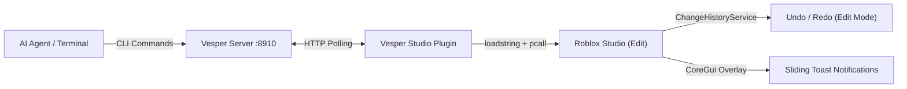

<div align="center">
  
  <h1>VESPER</h1>
  <p><strong>A small bridge between AI agents and Roblox Studio, driven from the command line</strong></p>

  <p>
    <a href="https://create.roblox.com"></a>
    &nbsp;&nbsp;
    <a href="https://nodejs.org"></a>
    &nbsp;&nbsp;
    <a href="LICENSE"></a>
  </p>
</div>

---

Vesper connects AI pair programmers (Antigravity, Claude Code, Cursor, Windsurf, Aider) and CLI scripts directly to **Roblox Studio**. 

It runs batch Luau builders and dumps the hierarchy in Edit Mode, with each run recorded as one `Ctrl+Z` step (`ChangeHistoryService`). `vesper test` runs a script in a Play session and returns PASS/FAIL with the game's logs, so an agent can check its own work, and `vesper shot` saves a screenshot of the viewport so it can see what it built. Inside a test, `shot("name")` saves a screenshot of the running game, so an agent can walk a character somewhere and look at the result.

Because it's a plain CLI, it adds no tool schemas to an agent's context, unlike an MCP server.

Built for Roblox developers building games on **Linux (Vinegar/Wine)**, **macOS**, and **Windows**.

---

## How It Works

Vesper consists of two lightweight pieces:
1. **The CLI (`vesper`)**: Runs on your machine, managing the bridge server on port `8910`.
2. **The Studio Plugin**: Runs inside Roblox Studio, executing Luau instructions with `Ctrl+Z` undo tracking in Edit Mode and in-viewport toasts.

---

## Setup & Getting Started

### 1. Install the CLI

```bash
# npm
npm install -g @raxelf/vesper

# bun
bun add -g @raxelf/vesper

# pnpm
pnpm add -g @raxelf/vesper
```

Or run directly without installing:

```bash
npx @raxelf/vesper serve
```

### 2. Auto-Install Studio Plugin

Run one command to detect your operating system (Linux Vinegar/Wine, macOS, Windows) and copy the plugin:

```bash
vesper setup
```

<details>
<summary>Manual Plugin Installation Paths</summary>

If you prefer manual copying, place `plugin/Vesper.server.lua` into:

| Operating System | Studio Plugins Directory |
|---|---|
| **Linux (Vinegar Flatpak)** | `~/.var/app/org.vinegarhq.Vinegar/data/vinegar/prefixes/studio/drive_c/users/$USER/AppData/Local/Roblox/Plugins/` |
| **Linux (Standard Wine)** | `~/.wine/drive_c/users/$USER/AppData/Local/Roblox/Plugins/` |
| **macOS** | `~/Library/Application Support/Roblox/Plugins/` |
| **Windows** | `%LOCALAPPDATA%\Roblox\Plugins\` |
</details>

### 3. Connect Studio

1. In Roblox Studio, open **Home** → **Game Settings** → **Security** and toggle **Allow HTTP Requests** ON.
2. In the **Plugins** ribbon, click the **Vesper** button and click **Connect to Bridge**.
3. Done! Run commands from your terminal or AI coding agent:

```bash
# Inspect hierarchy (path, optional depth; output capped at 400 lines)
vesper tree Workspace 3

# Run Luau in a Play session; prints PASS/FAIL plus game logs (default timeout 20s)
vesper test check.luau 30

# Save a PNG of the Studio viewport (Edit mode), optionally from a chosen camera
vesper shot /tmp/view.png --from 25,18,25 --at 0,7,0

# Execute Luau directly in Studio
vesper exec "Instance.new('Part', workspace).Name = 'VesperCube'"

# Run complex batch builder scripts
vesper run /tmp/build.luau
```

---

## CLI Reference

| Command | Arguments | Description |
|---|---|---|
| `vesper setup` | None | Auto-installs Studio plugin to your Roblox Plugins folder. |
| `vesper serve` | None | Starts bridge server in foreground on port `8910` (`Ctrl+C` to stop). |
| `vesper status` | None | Checks if server is running and Roblox Studio is connected. |
| `vesper tree` | `[path] [depth]` | Dumps hierarchy (defaults to `Workspace`, depth 4, max 400 lines). |
| `vesper run` / `vesper exec` | `<file.luau \| code>` | Executes a Luau file or inline string in Studio (one Ctrl+Z step). |
| `vesper test` | `<file.luau \| code> [seconds]` | Starts Play mode, runs the script server-side, returns PASS/FAIL and logs, then stops. Scripts can call `shot("name")` to save a screenshot of the running game to `/tmp/vesper-shots/name.png`; the paths are printed under SCREENSHOTS. |
| `vesper shot` | `[file.png] [--from x,y,z --at x,y,z] [--width n]` | Saves a PNG of the Studio 3D viewport (default `/tmp/vesper-shot.png`, 640 px wide, max 1280). With `--from` and `--at` the camera moves for the shot and is put back afterward. The 3D scene tab must be the active tab in Studio; with a script tab active the viewport renders blank and the command says so. This is for Edit mode; inside a Play test, use `shot("name")`. |
| `vesper version` | None | Prints current version string. |

> **Output cap:** `run`, `exec` and `test` print at most 200 lines (first 40 and last 160) so agents don't flood their context. Add `--full` to see everything.

> **Note:** Run `vesper serve` in a terminal when developing. Press `Ctrl+C` anytime to stop the server cleanly. The server listens on `127.0.0.1` only and rejects requests from browser pages.

---

## AI Agent Integration

Vesper is built for autonomous and interactive AI workflows. Add this rule to your agent system prompt or `.cursorrules`:

```markdown
# Roblox Studio AI Bridge (`vesper`)

For Roblox Studio manipulation, use the global CLI `vesper`:
- `vesper status` — Verify bridge server and Roblox Studio connection status.
- `vesper tree Workspace` — Inspect 3D world hierarchy, positions, sizes, and colors.
- `vesper run /tmp/build.luau` — Execute a batch Luau builder script in Studio.
- `vesper exec "print(...)"` — Run quick inline Luau commands.
- `vesper test check.luau` — Run a script in a Play session and read PASS/FAIL plus logs.
- **Rule**: Always batch 3D map/model generation into a single script written to `/tmp/build.luau` and executed via `vesper run /tmp/build.luau`.
- **Look**: After building or moving things, run `vesper shot /tmp/view.png --from x,y,z --at x,y,z`, then open the PNG to check the result. The 3D scene tab must be active in Studio.
- **Play-test**: In a `vesper test` script, call `shot("name")` after a key step (for example after walking the character to a part), then open the PNG to check what the game looks like.
- **Verify**: After changing or adding gameplay scripts (anything that runs at game time), write a short check to /tmp/check.luau and run `vesper test /tmp/check.luau`. Read the PASS/FAIL and logs, fix any errors, and rerun until it passes. Skip this for purely visual builds (parts, models, colors); use `vesper tree` to confirm those.
```

---

## Compared with an MCP server

Vesper does three jobs: run Luau, read the hierarchy, and test in a Play session with screenshots. An MCP server for Studio does those and more. The one I measured has 28 tools, including script editing, input simulation and asset generation, none of which Vesper has. If you need those, use an MCP server. The tables below compare only the jobs the two share.

The numbers come from one machine (Linux with Vinegar), one Studio session and one run, in October 2026. Treat them as an example, not a guarantee.

### Context cost

| | Vesper | MCP server |
|---|---|---|
| Fixed cost per session | about 244 tokens (the rule block above) | about 15,200 tokens for all 28 tool definitions, about 2,900 for the five that match Vesper's jobs |
| Run a Luau snippet (command and reply) | about 8 tokens | about 34 tokens |
| Read the hierarchy (Workspace, depth 1) | about 118 tokens | about 431 tokens |
| One screenshot | 640×345, about 294 image tokens | 1436×775, about 1,480 image tokens |

Token counts are estimates: text is characters divided by four, images are width times height divided by 750. Some clients load tool definitions only when a tool is first used, which shrinks the fixed cost for an MCP server. The two don't return identical data. Vesper's `run` returns what the script printed as well as its return value, while the MCP tool returned only the return value. Vesper's `tree` includes position, size and colour for every part, and the MCP tool returns paths and relationships as JSON.

### Speed

Round trip from sending a command to receiving the reply, in milliseconds. This leaves out model time.

| | Vesper p50 / p95 / p99 | MCP server p50 / p95 / p99 |
|---|---|---|
| Run a Luau snippet | 16 / 20 / 21 | 66 / 69 / 84 |
| Read the hierarchy | 16 / 19 / 21 | 33 / 50 / 52 |
| Screenshot | 576 / 631 / 676 | 599 / 648 / 746 |

Each row is 200 calls (40 for screenshots) with 0.4 seconds between calls, after 5 warm-up calls. Vesper was timed over HTTP to its server and the MCP server over stdio. The screenshot times include scaling in Vesper's case and JPEG encoding in the MCP server's case, so they aren't the same work.

Vesper has a rate ceiling. Roblox allows about 500 HTTP requests a minute per Studio, and Vesper spends two on each command, so more than roughly 250 commands a minute gets throttled. In one unpaced run of back-to-back calls, one command stalled for 15 seconds and the plugin lost its connection soon after. An agent that issues a command every few seconds stays far below the limit, but a script that sends hundreds of commands in a loop needs a short delay between them. I saw no throttling from the MCP server in my runs.

## Architecture



1. **Lightweight Server (`node:http`):** Binds to `127.0.0.1:8910`, queues client requests (`/cmd`), and answers the plugin's polls (`/poll`).
2. **Studio Plugin (`Vesper.server.lua`):** Polls the server asynchronously inside Studio, unpacks instructions, executes them (with `ChangeHistoryService` recordings in Edit mode), and posts results back (`/reply`).
3. **In-Viewport Toasts:** Studio viewport displays sliding status notifications confirming applied changes without requiring the developer to look at the output window.

---

## License

[MIT](LICENSE) © raxelf

Vesper is an independent project. It is not affiliated with or endorsed by Roblox.
